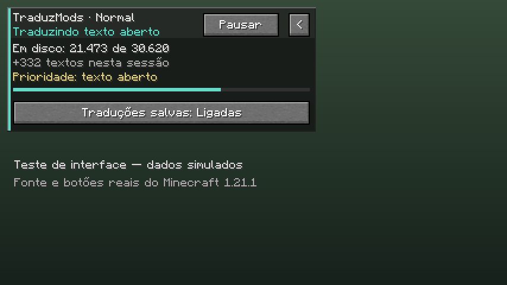

# TraduzMods 2.0.0 — desenvolvimento

Estado: **2.0.0-alpha.1**, candidata a testes. A [Release 1.0.0](https://github.com/xjoaquimx/TraduzMods/releases/tag/v1.0.0) continua sendo a versão estável. Seus seis JARs e hashes foram preservados. Os resultados locais desta etapa não constituem um lançamento estável nem uma publicação no CurseForge.

## Tradução e processamento

- A fila mantém um único nó por texto e promove, remove e conta trabalhos em tempo constante. Um texto já admitido continua podendo receber prioridade quando a fila atinge o limite.
- O glossário usa um índice de múltiplos termos para selecionar candidatos antes de aplicar as regras de palavras e plurais. Texto Unicode mantém o caminho completo para preservar as equivalências da expressão regular.
- Um cache de parágrafos evita repetir inferência quando textos diferentes contêm o mesmo trecho. A chave inclui a instrução, marcadores e referências de terminologia. O limite de carga estimada é 128 KiB na Lite e 512 KiB na Normal, com no máximo 256 entradas; isso é adicional ao cache persistente de textos completos.
- A instrução enviada ao Hy-MT é menor, com referências aos nomes nativos. O perfil compacto conserva até 400 caracteres dessas referências, evitando descartar nomes curtos de itens depois de nomes longos de ferramentas.
- A Normal permite CUDA no perfil compacto de leitura. CUDA usa gráficos de execução e carrega pesos com `--load-mode none`, opção validada no runtime fixado b11429. O perfil completo continua ajustando CPU e buffers aos recursos disponíveis.
- Enquanto uma tela de leitura permanece aberta, o modelo compacto fica pronto entre páginas. O catálogo cede prioridade ao texto aberto e só avança com o perfil e recursos apropriados. Um trecho que já está em inferência termina antes da passagem de prioridade. Quando a janela completa não cabe na RAM ou VRAM disponível, a Normal usa a janela compacta também para concluir o catálogo, um texto por pedido. A Lite mantém apenas o trabalho visível.

## Memória e armazenamento

O perfil compacto deixa de exigir a mesma reserva do catálogo. A admissão CPU pede aproximadamente 2,125 GiB livres; a admissão CUDA compacta pede 1,5 GiB de RAM livre, além de pelo menos 3 GiB de VRAM livre e driver compatível. CUDA compacta tem orçamento supervisionado de 2560 MiB para o processo; CPU compacta, 1792 MiB. A medição residente não é igual ao compromisso privado do processo.

Limites físicos ainda existem: com memória efetivamente esgotada, o modelo pode aguardar recursos ou ser descarregado. O cache continua disponível, rótulos conhecidos não dependem do modelo e o painel informa RAM livre e o mínimo necessário. Não se promete tradução sem RAM ou execução instantânea a frio.

Cada resultado aceito é gravado e sincronizado no registro durável **antes** de aparecer no jogo. A consolidação do cache e o snapshot periódico da fila aguardam enquanto há texto visível pendente. O encerramento força a consolidação. Os arquivos de cache/fila usam JSON compacto, compatível com a leitura dos arquivos anteriores. O desligamento da exibição das traduções salvas continua preservando os arquivos e a tradução de novos textos.

## Painel

O painel tem cabeçalho TraduzMods/Lite ou Normal, faixa de estado, contagem em disco, textos desta sessão e progresso. Mantém botões nativos de pausa/retomada, exibição do cache e recolhimento lateral. As áreas de clique e a animação acompanham as novas dimensões. O cliente real do Minecraft 1.21.1 carregou o mod e validou o desenho com fontes/botões nativos, pausa/retomada, exibição do cache e recolhimento. As contagens nas capturas são simuladas. A Normal foi instalada no ATM11 0.11.1-beta / NeoForge 26.1.2.109 e recebeu relato de uso satisfatório do autor. A verificação de todas as telas e dos demais modpacks continua pendente.



## Compatibilidade

| Minecraft | Loader | Estado desta etapa |
| --- | --- | --- |
| 1.20.1 | Fabric | Lite e Normal compiladas; integração e inferência nativa isolada verificadas |
| 1.21.1 | Fabric | Novo adaptador; ambas compiladas; mixins principais conferidos; cliente real e controles do painel exercitados |
| 26.2 | Fabric | Ambas compiladas e verificadas na suíte de integração |
| 26.1.2 | NeoForge | Ambas compiladas e verificadas na suíte de integração; Normal carregada no ATM11 com tradução real e relato de uso satisfatório |

Na alpha.4 foram executados **95 casos em cada variante: 760 sucessos, zero falhas**. As regressões novas e seus limites estão no [changelog técnico](CHANGELOG-2.0.0-alpha.4.md). As medições de inferência e microbenchmarks anteriores pertencem à alpha.1; não foram repetidas nesta correção. Isso não equivale a abrir todos os modpacks nem a medir FPS. Integrações opcionais de FTB Quests/FancyMenu na nova 1.21.1 precisam de ensaios com os respectivos mods presentes.

O núcleo e os testes compartilhados são conferidos por `python scripts/sync_shared_core.py`. Propagação explícita: `--write`. APIs de renderização, entrada, NBT e mixins ficam nos adaptadores; o script não sobrescreve esses adaptadores.

Para ampliar o suporte, o próximo grupo é Fabric/Forge/NeoForge entre 1.16 e 1.21, com testes de carregamento e de cada integração. Versões 1.8–1.12 exigem uma camada Java 8 própria: o núcleo atual utiliza records, APIs de processo e coleções posteriores ao Java 8. Não se anuncia compatibilidade com essas versões antes dessa adaptação e dos testes. A porta 1.21.1 é o primeiro passo, não uma garantia de suporte a todo Minecraft posterior à 1.7.

## Reproduzir

Gradle usa JDK 25; a variante 1.20.1 precisa também de JDK 17. A 1.21.1 gera classes Java 21, e as variantes 26 usam Java 25. Em cada pasta de loader:

```powershell
.\gradlew.bat build integrationTest -Pedition=normal '-Pmod_version=2.0.0-alpha.4-normal'
.\gradlew.bat build integrationTest -Pedition=lite '-Pmod_version=2.0.0-alpha.4-lite'
```

Na pasta Fabric 1.20.1 também estão disponíveis `optimizationBenchmark`, `persistenceBenchmark`, `modelComparisonFixtures` e `nativeOptimizationSmoke`. O último exige um diretório isolado com modelo/runtime já verificados; nunca use o cache de um jogador como diretório de ensaio.

```powershell
.\gradlew.bat modelComparisonFixtures -Pedition=normal -PfixtureMode=prepare '-PfixtureFile=C:/bench/fixtures.json'
python ../../../scripts/benchmark_models.py --runtime C:/bench/runtime-cuda/llama-server.exe --backend cuda --model Q4_K_M=C:/bench/Q4_K_M.gguf --model Q6_K=C:/bench/Q6_K.gguf --fixtures C:/bench/fixtures.json --output C:/bench/comparacao-nova
```

O script requer Python 3.11+ e `psutil`, não baixa arquivos, utiliza servidor autenticado apenas em loopback, respeita a trava global do mod e encerra somente seu próprio processo. `--output` precisa apontar para uma pasta nova. O resultado automático verifica conclusão da resposta; a restauração de nomes/formatação e a revisão do sentido são etapas separadas.

Veja [o changelog técnico](CHANGELOG-2.0.0-alpha.1.md), [a configuração do PC do autor e a comparação dos modelos](BENCHMARK-2.0.md).
